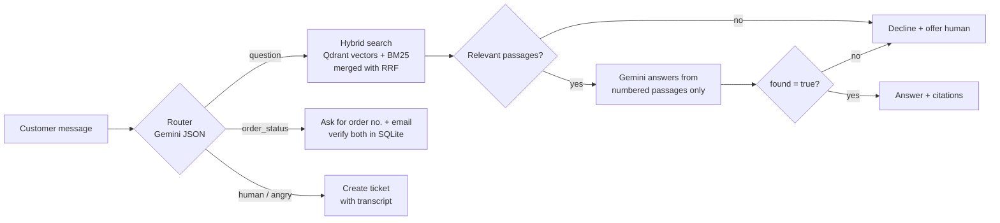

# SupportBot: RAG Customer Support Chatbot with Citations & Human Handoff

A support chatbot for an online store that answers **only from the store's own documents**, shows the source of every answer, checks order status after verifying the customer, and hands the conversation to a human when it can't help.

> **Demo project.** "Pinecrest Trail Co." is a fictional outdoor-gear store. All documents, products and orders in `data/` are made up for this demo.

<!-- Add a 20-second GIF of the chat here: docs/demo.gif -->

## What it does

| Customer asks | SupportBot does |
| --- | --- |
| "How long does standard shipping take?" | Answers from `shipping.md` and cites the section |
| "How much is a weekend tent rental?" | Answers from the rental PDF and cites **page 1** |
| "Do you sell kayaks?" | Says it isn't in the docs instead of guessing, offers a human |
| "Where is my order?" | Asks for order number + email, verifies both, then shows status and tracking |
| "This is ridiculous, my tent arrived broken" | Detects an upset customer, creates a ticket with the full transcript |

## Results

Measured with `eval/run_eval.py` on 40 questions (30 answerable from the docs, 10 that are not).

| Pipeline | Retrieval hit@5 | Correct answers | Correct refusals | Overall |
| --- | --- | --- | --- | --- |
| Baseline: vector search only, no guardrail | _run eval_ | _run eval_ | _run eval_ | _run eval_ |
| SupportBot: hybrid search + guardrail | _run eval_ | _run eval_ | _run eval_ | _run eval_ |

<!-- Replace the cells above with the numbers from eval/results.md after running the eval with Gemini. -->

## How it works



Key design decisions:

- **Hybrid retrieval.** Vector search understands meaning ("send it back" ≈ "return"); BM25 keyword search catches exact terms (SKUs, order numbers, "30 days"). The two ranked lists are merged with Reciprocal Rank Fusion.
- **Two-step guardrail.** A cheap pre-check skips the LLM when neither search finds anything relevant. Otherwise the LLM must return `found: false` when the passages don't contain the answer. Either way the customer gets an honest "I don't know" plus a handoff offer, never an invented policy.
- **Citations with metadata.** Every chunk keeps its file name, heading path and PDF page, so answers point to the exact source.
- **Safe order lookup.** Order details are shown only when the order number **and** email match. A wrong email gets the same message as a wrong number, so the bot doesn't reveal which orders exist.
- **Fails gracefully.** Gemini calls are paced under the quota and retried on rate limits and outages. If the model is still unavailable, the customer gets a polite message with the support email, never an error page.
- **Offline mode.** `LLM_PROVIDER=fake` runs everything (app, tests, eval) without an API key, which keeps tests fast and free.

## Quick start (Mac / Linux)

Requirements: Python 3.11+ and a free Gemini API key from [Google AI Studio](https://aistudio.google.com/apikey).

```bash
git clone https://github.com/<your-username>/ai-support-chatbot-rag.git
cd ai-support-chatbot-rag
python3 -m venv .venv && source .venv/bin/activate
pip install -r requirements-dev.txt
cp .env.example .env          # then open .env and paste your GEMINI_API_KEY
uvicorn app.main:app --reload
```

Open http://localhost:8000 for the chat. For the admin page (upload documents, see handoff tickets), set `ADMIN_PASSWORD` in `.env`, restart, and open http://localhost:8000/admin with user name `admin`. The first start builds the search index from `data/docs/`.

Try it without a key: `LLM_PROVIDER=fake uvicorn app.main:app`

### With Docker

```bash
docker build -t supportbot .
docker run -p 8000:8000 --env-file .env -v supportbot-data:/app/data supportbot
```

The volume keeps the index, tickets, chat sessions and uploaded documents across restarts.

## Run the tests and the evaluation

```bash
pytest -q                      # offline, no API key needed
python -m eval.run_eval        # uses Gemini; writes eval/results.md
```

The eval builds its own copy of the index, so it can run while the server is running.

It saves every graded question to `eval/.cache.json`. If a run stops (quota, network, Ctrl+C), run the same command again and it continues where it stopped. Changing a prompt, model, setting or document re-runs only what that change affects; `--fresh` re-runs everything.

On the Gemini free tier, each model has a per-minute and a per-day request limit. The client paces requests (`GEMINI_RPM`), waits when the API asks it to, and stops with a clear message when the daily limit is reached. Setting `JUDGE_MODEL` to a different model splits the eval's calls across two quotas.

## Use your own documents

Upload `.md`, `.txt`, `.pdf` or `.csv` files on the `/admin` page, or drop them into `data/docs/` and call `POST /admin/api/ingest`. Uploads are parsed before they are saved: an unreadable or scanned PDF is rejected and the live index is untouched. Edit `data/orders.csv` to change the mock orders.

## API

| Method | Path | Auth | What it does |
| --- | --- | --- | --- |
| POST | `/api/chat` | none (rate limited) | `{"session_id": "...", "message": "..."}` → answer, action, citations, ticket id |
| GET | `/api/health` | none | Status and number of indexed chunks |
| POST | `/admin/api/upload` | admin | Upload a document and re-index |
| POST | `/admin/api/ingest` | admin | Re-index everything in `data/docs/` |
| GET | `/admin/api/documents` | admin | List indexed documents |
| GET | `/admin/api/tickets` | admin | List handoff tickets with transcripts |

Admin endpoints use HTTP Basic auth: user `admin`, password `ADMIN_PASSWORD`.

## Production notes

What is already handled:

| Area | How |
| --- | --- |
| Admin security | Password-protected admin page and API (constant-time check); switched off when no password is set |
| Abuse and cost | Per-IP rate limit on chat (`CHAT_RATE_LIMIT`), 2,000-character message limit, one ticket per conversation, order lookup locked after 3 wrong number/email pairs |
| Prompt injection | Customer text and document passages are treated as data; the model is told not to follow instructions inside them |
| Reliability | Re-index builds a new index version and swaps it in, so chat keeps working during updates; broken files are skipped; uploads are validated before they reach the docs folder |
| Model outages | Request pacing per model, retries with backoff, fast stop on daily quota, friendly fallback reply |
| State | Chat sessions in SQLite (expire after `SESSION_TTL_HOURS`), so restarts don't lose conversations |
| Operations | Request log with IDs and latency, `/api/health` + Docker healthcheck, non-root container, data volume, optional Slack webhook for new tickets |

Limits of this setup, and the next step when you outgrow it:

- **One server process.** Local Qdrant, SQLite and the in-memory rate limiter live in one process. To run several instances, move to Qdrant server (or pgvector), Postgres and Redis.
- **Order lookup is a demo.** Replace the SQLite order table with the store's real API (Shopify, WooCommerce) and its customer authentication.
- **Admin auth is a single password.** For a team, put the admin behind SSO or a proper user system.
- **Gemini free tier is small.** Each chat message makes 2 model calls; enable billing before real traffic.

## Project structure

```
app/
  config.py      settings from .env
  llm.py         Gemini client with retries + offline FakeLLM
  ingest.py      load md/pdf/csv, chunk with source metadata
  retrieval.py   Qdrant vector search + BM25 + RRF fusion
  agent.py       routing, grounded answers, guardrail, order lookup, handoff
  db.py          SQLite: mock orders, tickets, chat sessions
  ratelimit.py   per-IP sliding-window rate limiter
  notify.py      optional webhook (Slack) for new tickets
  main.py        FastAPI endpoints, admin auth, request logging
static/          chat page and admin page
data/docs/       demo store documents (markdown, PDF, CSV)
eval/            40-question test set and evaluation script
tests/           offline pytest suite (23 tests)
```

## Configuration

All settings live in `.env` (see `.env.example`): `CHAT_MODEL`, `EMBEDDING_MODEL`, `RETRIEVAL_MODE` (`hybrid` or `vector`), `TOP_K`, `MIN_SIMILARITY`, `CHUNK_SIZE`, `CHUNK_OVERLAP`. Change one, re-run the eval, and compare.

## Tech stack

Python · FastAPI · Google Gemini API (chat + embeddings) · Qdrant (local mode) · rank-bm25 · SQLite · pypdf · Docker · pytest
