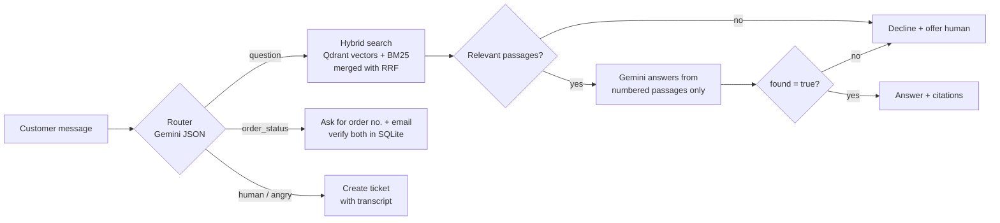

# SupportBot: RAG Customer Support Chatbot with Citations & Human Handoff

A support chatbot for an online store that answers **only from the store's own documents**, shows the source of every answer, checks order status after verifying the customer, and hands the conversation to a human when it can't help.

> **Demo project.** "Pinecrest Trail Co." is a fictional outdoor-gear store. All documents, products and orders in `data/` are made up for this demo.

<!-- Add a 20-second GIF of the chat here: docs/demo.gif -->

## What it does

| Customer asks | SupportBot does |
| --- | --- |
| "How long does standard shipping take?" | Answers from `shipping.md` and cites the section |
| "How much is a weekend tent rental?" | Answers from the rental PDF and cites **page 1** |
| "Do you sell kayaks?" | Says it isn't in the docs instead of guessing, offers a human |
| "Where is my order?" | Asks for order number + email, verifies both, then shows status and tracking |
| "This is ridiculous, my tent arrived broken" | Detects an upset customer, creates a ticket with the full transcript |

## Results

Measured with `eval/run_eval.py` on 40 questions (30 answerable from the docs, 10 that are not).

| Pipeline | Retrieval hit@5 | Correct answers | Correct refusals | Overall |
| --- | --- | --- | --- | --- |
| Baseline: vector search only, no guardrail | _run eval_ | _run eval_ | _run eval_ | _run eval_ |
| SupportBot: hybrid search + guardrail | _run eval_ | _run eval_ | _run eval_ | _run eval_ |

<!-- Replace the cells above with the numbers from eval/results.md after running the eval with Gemini. -->

## How it works



Key design decisions:

- **Hybrid retrieval.** Vector search understands meaning ("send it back" ≈ "return"); BM25 keyword search catches exact terms (SKUs, order numbers, "30 days"). The two ranked lists are merged with Reciprocal Rank Fusion.
- **Two-step guardrail.** A cheap pre-check skips the LLM when neither search finds anything relevant. Otherwise the LLM must return `found: false` when the passages don't contain the answer. Either way the customer gets an honest "I don't know" plus a handoff offer, never an invented policy.
- **Citations with metadata.** Every chunk keeps its file name, heading path and PDF page, so answers point to the exact source.
- **Safe order lookup.** Order details are shown only when the order number **and** email match. A wrong email gets the same message as a wrong number, so the bot doesn't reveal which orders exist.
- **Retries.** Gemini calls retry with backoff on rate limits and timeouts. If the model is down, the API returns a clear 503 instead of crashing.
- **Offline mode.** `LLM_PROVIDER=fake` runs everything (app, tests, eval) without an API key, which keeps tests fast and free.

## Quick start (Mac / Linux)

Requirements: Python 3.11+ and a free Gemini API key from [Google AI Studio](https://aistudio.google.com/apikey).

```bash
git clone https://github.com/<your-username>/ai-support-chatbot-rag.git
cd ai-support-chatbot-rag
python3 -m venv .venv && source .venv/bin/activate
pip install -r requirements-dev.txt
cp .env.example .env          # then open .env and paste your GEMINI_API_KEY
uvicorn app.main:app --reload
```

Open http://localhost:8000 for the chat and http://localhost:8000/admin to upload documents and see handoff tickets. The first start builds the search index from `data/docs/`.

Try it without a key: `LLM_PROVIDER=fake uvicorn app.main:app`

### With Docker

```bash
docker build -t supportbot .
docker run -p 8000:8000 --env-file .env supportbot
```

## Run the tests and the evaluation

```bash
pytest -q                      # offline, no API key needed
python -m eval.run_eval        # uses Gemini; writes eval/results.md
```

The eval builds its own copy of the index, so it can run while the server is running. It makes about 160 model calls; on the Gemini free tier (15 requests/minute) the built-in rate limiter (`GEMINI_RPM=12`) makes it take roughly 15 minutes. If a 429 quota error still happens, the client waits as long as the API asks and retries.

## Use your own documents

Drop `.md`, `.txt`, `.pdf` or `.csv` files into `data/docs/` and call `POST /api/ingest`, or upload them on the `/admin` page. Edit `data/orders.csv` to change the mock orders.

## API

| Method | Path | What it does |
| --- | --- | --- |
| POST | `/api/chat` | `{"session_id": "...", "message": "..."}` → answer, action, citations, ticket id |
| POST | `/api/upload` | Upload a document and re-index |
| POST | `/api/ingest` | Re-index everything in `data/docs/` |
| GET | `/api/documents` | List indexed documents |
| GET | `/api/tickets` | List handoff tickets with transcripts |
| GET | `/api/health` | Status and number of indexed chunks |

## Project structure

```
app/
  config.py      settings from .env
  llm.py         Gemini client with retries + offline FakeLLM
  ingest.py      load md/pdf/csv, chunk with source metadata
  retrieval.py   Qdrant vector search + BM25 + RRF fusion
  agent.py       routing, grounded answers, guardrail, order lookup, handoff
  db.py          SQLite: mock orders and tickets
  main.py        FastAPI endpoints
static/          chat page and admin page
data/docs/       demo store documents (markdown, PDF, CSV)
eval/            40-question test set and evaluation script
tests/           offline pytest suite
```

## Configuration

All settings live in `.env` (see `.env.example`): `CHAT_MODEL`, `EMBEDDING_MODEL`, `RETRIEVAL_MODE` (`hybrid` or `vector`), `TOP_K`, `MIN_SIMILARITY`, `CHUNK_SIZE`, `CHUNK_OVERLAP`. Change one, re-run the eval, and compare.

## Tech stack

Python · FastAPI · Google Gemini API (chat + embeddings) · Qdrant (local mode) · rank-bm25 · SQLite · pypdf · Docker · pytest
